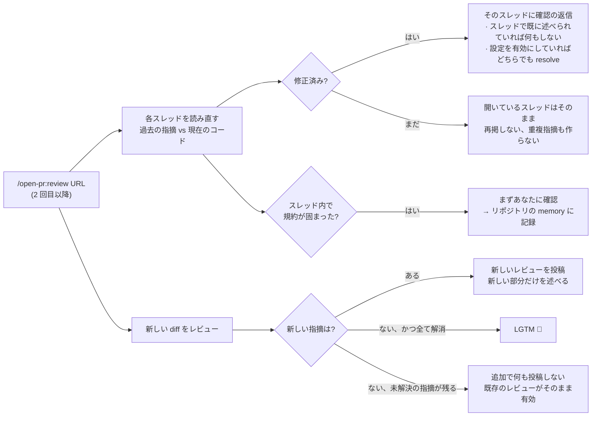
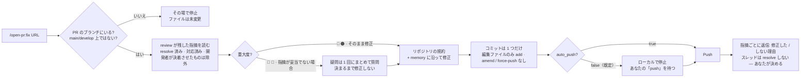

# 再レビュー / fix のフロー

[← README](../../README.ja-JP.md)

`/open-pr:review` は PR のコードを専用の **git worktree** にチェックアウトします — 作業中のブランチには触れません。レビュー中もそのまま開発を続けられます。

PR が変更した箇所だけでなく、その周辺のロジックもスコープに入るので、diff の外にある deadcode や業務ロジックのバグも拾えます。スコープ外だが重要なものは、必ず直すべき finding ではなく、あなたが判断するための **アドバイス** として返します。

## 再レビュー（2 回目以降）

同じチャットセッション内なら、開発者が修正または返信したあと、同じ PR で `/open-pr:review` を再入力するだけで十分です — **ゼロからやり直さず**、前回の続きから進みます:



> [!TIP]
> スレッド内で固まった規約は、必ず **先にあなたに確認してから** memory に書きます。

## `/open-pr:fix`

逆方向に進みます: `review` が残した指摘そのものを読み、**実コード** を修正します。



> [!WARNING]
> `fix` は、あなたが立っているリポジトリの実コードを編集します。ブランチ違いや PR 違いなら即座に停止します。

## 1 回に 1 実行

コマンドは自分で入力したときだけ実行されます。submodule にも対応します。URL の後ろに書いた指示は **その実行にだけ** 適用されます:

```bash
/open-pr:review https://github.com/org/repo/pull/123 [指示]
/open-pr:fix    https://github.com/org/repo/pull/123 [指示]
```

1 つのコマンドに PR URL を複数渡すと、それぞれを最後まで処理してから次に進みます。互いに持ち越すものはありません: worktree もコメントも別々です。`/open-pr:fix` はさらに、submodule の PR を、それを bump するメイン PR より先に処理し、PR ごとに commit します。

リポジトリでの初回は短い質問をまとめて訊きます — PR に投稿する言語、即投稿かドラフトか、修正済みスレッドを自動 resolve するか、ドキュメントを読み直す間隔、大きすぎる PR / ファイルのしきい値 — そのうえで、すでにある規約を読みに行きます: README、CLAUDE.md、AGENTS.md、docs、wiki。

## 壊れたとき

あなたのマシンで、プラグインが想定していない形でコマンドが失敗したとき — クラッシュ、ツールのエラー、読めない出力 — エージェントは推測で進めず、止まってあなたと一緒に対処します:

1. あなた自身が直すもの（ツールがない、jq が 1.6 より古い、トークン切れ、権限なし、ネットワーク、シェルのサンドボックス）なら、やることを伝えるだけで何もパッチしません。
2. それ以外なら `open-pr.sh selftest` を実行し — プラットフォーム、ツール、jq、macOS ではこの Mac のアーキテクチャでメニューバーとトーストが起動できるか — インストール済みプラグインを診断してパッチするか訊きます。
3. パッチが触るのはプラグイン自身の `bin/` スクリプトだけ — あなたのリポジトリ、設定、メモリには触れず — セキュリティチェックを弱めることもありません。まず diff 全体を見せ、承認したときだけ適用します。元のファイルはバックアップされ、再実行でまだ失敗すれば元に戻します。
4. パッチは一時的です: 次のプラグイン更新で置き換わります。
5. 最後に `/open-pr:feedback` を提案し、エラー、あなたの環境、diff をメンテナーに届けます — あなたを特定できる情報は取り除き、本文をあなたが承認してから投稿します。

途中まで投稿されたレビューの途中でパッチすることはありません: PR に何が出ているかを報告して止まります。`/open-pr:watch` と `/open-pr:menubar` は開始時にセルフテストを実行するので、動かせないマシンでは最初にそう伝えます。

## 他のプラットフォームでも同じレビュー

エージェントがたどる手順全体は **1 か所** にあります: `src/` 以下の markdown です。

Cursor・Codex・Gemini CLI・Antigravity はスラッシュコマンドを出すためにそれぞれ独自の入口ファイルが必要なので、それぞれに短いシムを置きます。シムの仕事はちょうど 2 つ: プラグインの設置場所を見つけ、同じコマンドファイルに引き継ぐ。ルール・しきい値・重大度をシムで言い直すことはしません。

---

[インストール](./install.md) · [設定](./configuration.md) · [結果の見え方](./demo.md)
